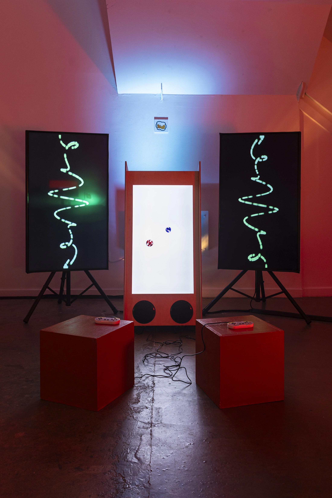
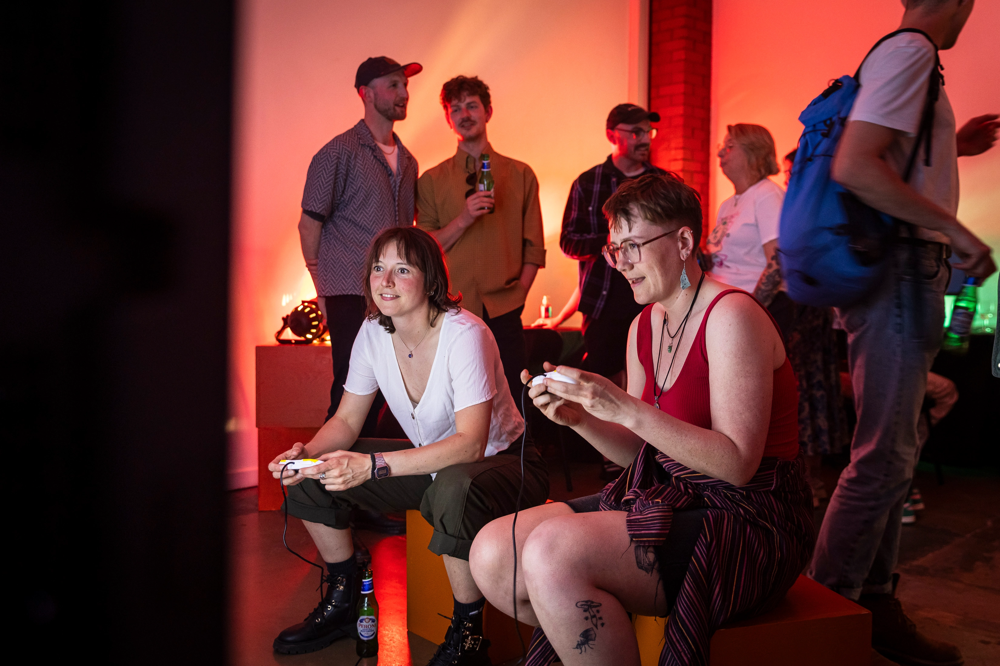
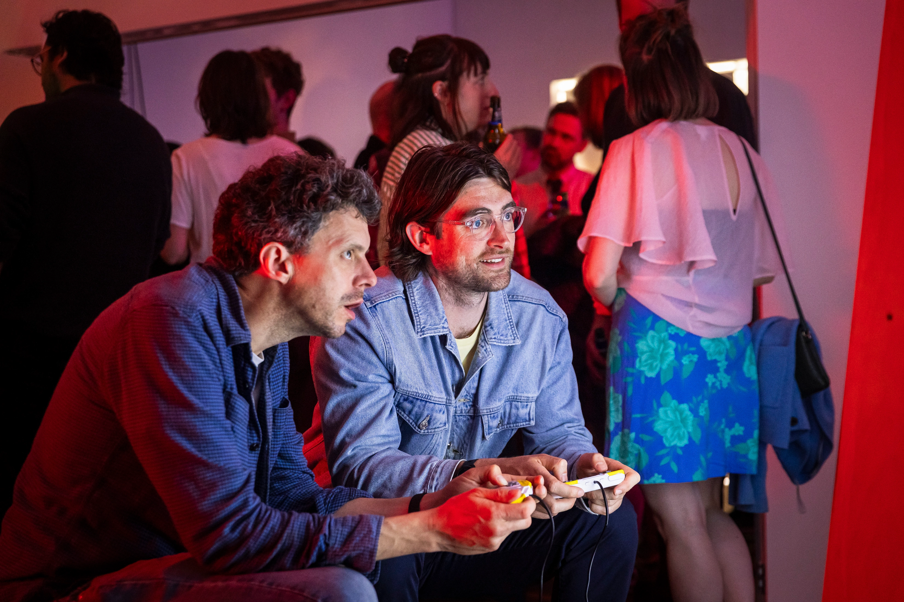
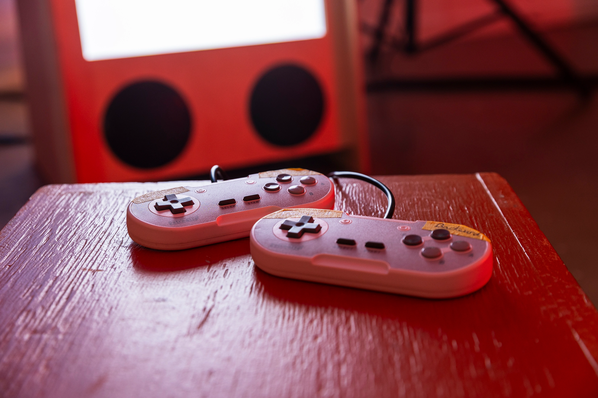

# Connection - A Quantum Entanglement Art Installation



- [Connection - A Quantum Entanglement Art Installation](#connection---a-quantum-entanglement-art-installation)
  - [Information](#information)
  - [Setup](#setup)
  - [Controls](#controls)
  - [Audio (Web feature TBC)](#audio-web-feature-tbc)

## Information

Connection is an interactive game where two players take control of a pair of joined particles, drifting endlessly in a void.

I built the game using a combination of THREE.js, Max/MSP, Ableton Live, Express.js running locally on the Arcade Unit provided by [Soundplay Projects, Glasgow](https://www.soundplayprojects.com/about-us-meet-the-team/).

The installation was showcased at [Many Studios, Glasgow](https://www.manystudios.co.uk/) for a Quantum Technologies, public incubator funded by the University of Glasgow. The incubator was in an attempt to bring the wonders of qunatum technology into the public space through a partnership with local art communities - in an effort to increase public awareness of quantum science and current research that is ongoing.



Directed and coordinated by Alistair Inglis (Uni of Glasgow), local Glasgow artists created several installation peices focusing on specific Quantum subjects. Regular meetings and discussions took place leading up to the event alongside marketing efforts to increase public engagement.



The show sold out on public launch, with many people from the University and the general public attending. The other installations and guide for the event can be found [here](https://qntm-exhib.vercel.app/).

<hr/>
<i> "Two particles intertwined. Born together. Perfectly correlated.

No matter how far apart you move them, they will stay connected."

-Alistair Inglis, Quantum Technologies Researcher (UoG)<i>

<hr/>

<video controls src="images/Screen Recording 2026-10-17 at 11.56.11.mov" title="demo" autoplay="true" loop="true"></video>

## Setup

```
# clone the repo down
cd two_particles
npm i
npm run start
```

The project will run in your browser port `5173`.

## Controls


In this installation I used Soundplay Projects controller connected to their hardware. I have adapted the project to now use QWERTY keyboard buttons as can be find below:

```
# Sphere 1
a - left
s - down
d - right
w - up
q - forward
e - backwards

# Sphere 2
j - left
k - down
l - right
i - up
u - forward
o - backwards
```

## Audio (Web feature TBC)

Without Max/MSP and Ableton running the audio samples will not play. I will be working on a fix for the browser whereby the movement audio samples will be triggered like they were in the exhibition.
